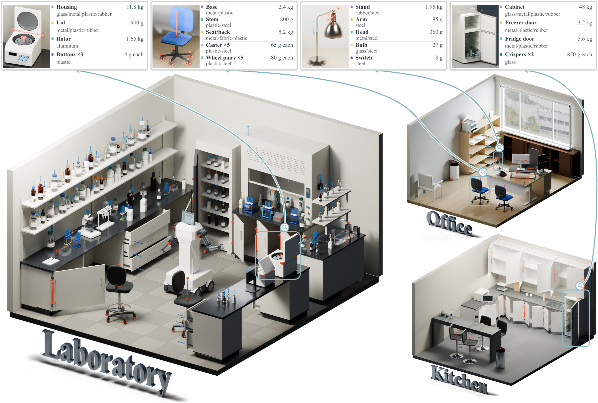

# Towards Physically Grounded Articulated 3D Assets: A Multi-Agent Pipeline and Benchmark


<p align="center">


</p>

<p align="center">

</p>

## Overview

Official implementation of **Artisan**, a multi-agent pipeline for physically grounded articulated 3D asset generation. Design, Coding and Review agents combine procedural modeling with physical simulation feedback.

## Quickstart

### 1. Install

On Ubuntu or Debian (Linux x86_64), run from the project root:

```bash
./install.sh
```

### 2. Add API keys

Set `OPENAI_API_KEY` in `.artisan/credentials.env`, then check the installation:

```bash
./run.sh doctor
```

### 3. Create an asset

```bash
./run.sh run "A black countertop microwave with a flush dark door, a keypad down the right-hand side and a small display above it. The door swings open a quarter turn on its left-hand hinge to reveal the cavity, and the glass turntable plate inside rotates freely." \
  --image ./assets/examples/microwave.png
```

The default is GPT-6 Astra with high reasoning effort and a $15 budget per case.
Reference image is optional and repeat `--image` to input multiple images.

### 4. Open the viewer

```bash
./run.sh viewer
```

Open <http://127.0.0.1:8765> to inspect generated assets and move their joints.


## Configuration

Edit `.artisan/config.toml`; the launcher reads it automatically. The main defaults are:

```toml
[artisan]
model = "gpt-6-astra"
thinking = "high"
max_cost_usd = 15.0
compaction_model = "gpt-5.6-sol"
image_tool_model = "gpt-image-2.5-sunburst"
cpu_threads = 1
render_device = "cpu"
```

Override settings with `--model`, `--thinking` and `--max-cost-usd`.
The budget covers the entire pipeline per case.

Paths in TOML are relative to the configuration file. See
[artisan.example.toml](artisan.example.toml) for additional settings.


## Benchmarks

See [benchmark/README.md](benchmark/README.md) for datasets, batch generation and evaluation.


## Documentation

- [Configuration example](artisan.example.toml)
- [SDK model contract](sdk/_docs/model_contract.md)

## Citation

```bibtex
@misc{cai2026artisan,
  title  = {Towards Physically Grounded Articulated 3D Assets: A Multi-Agent Pipeline and Benchmark},
  author = {Cai, Xudong and Zhu, Ruijie and Shang, Haoliang and Li, Ruining and
            Pollefeys, Marc and Wu, Shangzhe and Vedaldi, Andrea and Zheng, Chuanxia},
  year   = {2026}
}
```

## Acknowledgements

Artisan builds on [Articraft](https://github.com/mattzh72/articraft).
We thank [Particulate](https://github.com/RuiningLi/particulate) for its articulated
geometry evaluation protocol, and [ArtVIP](https://x-humanoid-artvip.github.io/),
[Lightwheel](https://github.com/LightwheelAI/Lightwheel-simready-asset) and
[ABO](https://amazon-berkeley-objects.s3.amazonaws.com/index.html) for their datasets.
We also thank the developers of [CadQuery](https://github.com/CadQuery/cadquery),
[cq_gears](https://github.com/meadiode/cq_gears), [Blender](https://www.blender.org/),
[MuJoCo](https://github.com/google-deepmind/mujoco),
[CoACD](https://github.com/SarahWeiii/CoACD) and [ambientCG](https://ambientcg.com/).

## License

See [LICENSE](LICENSE), [NOTICE](NOTICE) and [THIRD_PARTY.md](THIRD_PARTY.md).
