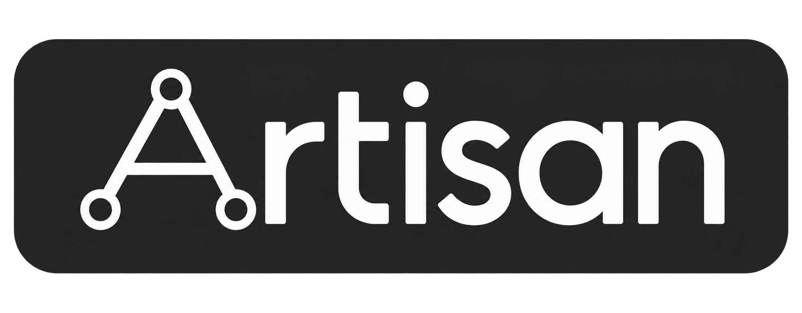

<p align="center">
  
</p>

<h3 align="center"><strong>Towards Physically Grounded Articulated 3D Assets:<br>A Multi-Agent Pipeline and Benchmark</strong></h3>

<p align="center">
  <a href="https://master-cai.github.io/">Xudong Cai</a>,
  <a href="https://ruijiezhu94.github.io/ruijiezhu/">Ruijie Zhu</a>,
  <a href="https://www.linkedin.com/in/haoliang-shang-1544b1116">Haoliang Shang</a>,
  <a href="https://ruiningli.com/">Ruining Li</a>,<br>
  <a href="https://people.inf.ethz.ch/pomarc/">Marc Pollefeys</a>,
  <a href="https://elliottwu.com/">Shangzhe Wu</a>,
  <a href="http://www.robots.ox.ac.uk/~vedaldi">Andrea Vedaldi</a>,
  <a href="https://physicalvision.github.io/people/~chuanxia">Chuanxia Zheng</a>
</p>

<p align="center">
  <!-- Replace xxxxx with the arXiv identifier and add the paper link when available. -->
   &nbsp;&nbsp;&nbsp;
  <a href="https://physicalvision.github.io/artisan"></a> &nbsp;&nbsp;&nbsp;
  <a href="https://huggingface.co/datasets/mastercai/Artisan-Benchmark"></a> &nbsp;&nbsp;&nbsp;
  <a href="LICENSE"></a> &nbsp;&nbsp;&nbsp;
  <a href="https://physicalvision.github.io/artisan"></a>
</p>

<br>

<p align="center">
  
</p>

> We introduce **Artisan**, a multi-agent pipeline for physically grounded articulated 3D asset generation. Given a text description and optional reference images, Design, Coding and Review agents combine procedural modeling with physical simulation feedback to create articulated assets.

This repository contains the official implementation and benchmark for Artisan.

If you find Artisan useful, **please help ⭐ this repo**. Thanks for supporting our work!

## 🚀 Quick Start

### 🛠️ Installation

Clone the repository:

```bash
git clone https://github.com/physicalvision/Artisan.git
cd Artisan
```

On Ubuntu or Debian (Linux x86_64), install from the project root:

```bash
./install.sh
```

Set `OPENAI_API_KEY` in `.artisan/credentials.env`, then check the installation:

```bash
./run.sh doctor
```

### 🔥 Asset Generation

Generate an articulated asset from a text description and a reference image:

```bash
./run.sh run "A black countertop microwave with a flush dark door, a keypad down the right-hand side and a small display above it. The door swings open a quarter turn on its left-hand hinge to reveal the cavity, and the glass turntable plate inside rotates freely." \
  --image ./assets/examples/microwave.png
```

The default is GPT-6 Astra with high reasoning effort and a $15 budget per case.
Reference images are optional; repeat `--image` to provide multiple images.

### 🧭 Visualization

Launch the interactive viewer:

```bash
./run.sh viewer
```

Open <http://127.0.0.1:8765> to inspect generated assets and move their joints.


## ⚙️ Configuration

Edit `.artisan/config.toml`; the launcher reads it automatically. The main defaults are:

```toml
[artisan]
model = "gpt-6-astra"
thinking = "high"
max_cost_usd = 15.0
compaction_model = "gpt-5.6-sol"
image_tool_model = "gpt-image-2.5-sunburst"
cpu_threads = 1
render_device = "cpu"
```

Override settings with `--model`, `--thinking` and `--max-cost-usd`.
The budget covers the entire pipeline per case.

Paths in TOML are relative to the configuration file. See
[artisan.example.toml](artisan.example.toml) for additional settings.


## 📊 Benchmark and Evaluation

Download [Artisan-Benchmark](https://huggingface.co/datasets/mastercai/Artisan-Benchmark)
and place the dataset folders under `benchmark/data/`:

```text
benchmark/data/
├── ArtVIP/
├── LightWheel/
├── Stability/
└── ABO-Mass/
```

Generate assets for a dataset:

```bash
.artisan/venv/bin/python benchmark/run.py --dataset ArtVIP --all
```

Evaluate appearance, geometry, materials and collisions:

```bash
.artisan/venv/bin/python benchmark/Evaluation/Fidelity/evaluate.py --dataset ArtVIP --mode all
.artisan/venv/bin/python benchmark/Evaluation/Collision/evaluate.py --dataset ArtVIP
```

The benchmark also includes stability and mass evaluation. See
[benchmark/README.md](benchmark/README.md) for all datasets, generation commands,
evaluation modes and output formats.

## 📚 Documentation

- [Configuration example](artisan.example.toml)
- [SDK model contract](sdk/_docs/model_contract.md)

## 📜 Citation

If you find our work useful, please cite:

```bibtex
@misc{cai2026artisan,
  title  = {Towards Physically Grounded Articulated 3D Assets: A Multi-Agent Pipeline and Benchmark},
  author = {Cai, Xudong and Zhu, Ruijie and Shang, Haoliang and Li, Ruining and
            Pollefeys, Marc and Wu, Shangzhe and Vedaldi, Andrea and Zheng, Chuanxia},
  year   = {2026}
}
```

## 🤝 Acknowledgements

Artisan builds on [Articraft](https://github.com/mattzh72/articraft).
We thank [Particulate](https://github.com/RuiningLi/particulate) for its articulated
geometry evaluation protocol, and [ArtVIP](https://x-humanoid-artvip.github.io/),
[Lightwheel](https://github.com/LightwheelAI/Lightwheel-simready-asset) and
[ABO](https://amazon-berkeley-objects.s3.amazonaws.com/index.html) for their datasets.
We also thank the developers of [CadQuery](https://github.com/CadQuery/cadquery),
[cq_gears](https://github.com/meadiode/cq_gears), [Blender](https://www.blender.org/),
[MuJoCo](https://github.com/google-deepmind/mujoco),
[CoACD](https://github.com/SarahWeiii/CoACD) and [ambientCG](https://ambientcg.com/).

## 📄 License

Artisan is released under the [Apache License 2.0](LICENSE). See
[NOTICE](NOTICE) and [THIRD_PARTY.md](THIRD_PARTY.md) for attribution and third-party licenses.
